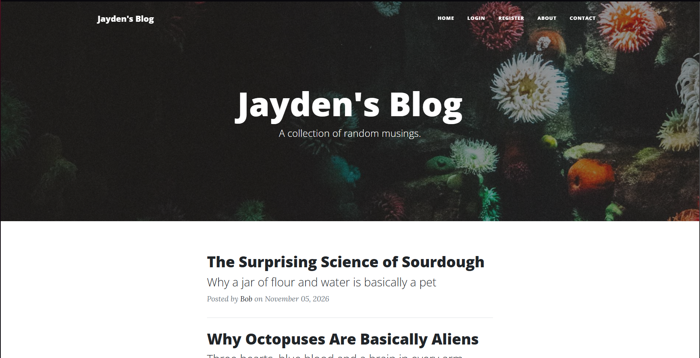

# Blog With Users

A multi-user blog built with Flask. Visitors can register and log in to comment on posts, and the first registered user becomes the admin, who can create, edit and delete posts. The project also includes a contact form that can send messages by email.

## About this project

I built this project during the *100 Days of Code: The Complete Python Pro Bootcamp* course by Dr. Angela Yu. The course provided the project brief and front-end template, and I wrote the Python code and my own template edits.

## Preview



## Features

- User registration and login with hashed passwords (Flask-Login and Werkzeug)
- Admin-only routes for creating, editing and deleting posts
- Rich-text editing for posts and comments with CKEditor
- Comments on every post, shown with the commenter's name
- Contact form that emails the site owner through SMTP, or prints the message to the console when email isn't configured
- Form validation and CSRF protection with Flask-WTF
- Responsive layout using Bootstrap 5

## Tech stack

- Python 3.14
- Flask, Flask-Login, Flask-WTF, Flask-CKEditor, Bootstrap-Flask
- SQLAlchemy and Flask-SQLAlchemy (SQLite locally, PostgreSQL in production)
- Gunicorn for deployment

## Getting started

These steps run the project locally with a SQLite database. No external services are needed.

1. Clone the repository and open the project folder:
   ```
   git clone https://github.com/jaydenbau-cmd/BlogWithUsers.git
   cd <project-folder>
   ```

2. Create and activate a virtual environment:
   ```
   python -m venv .venv

   # Windows (PowerShell)
   .venv\Scripts\Activate.ps1

   # macOS / Linux
   source .venv/bin/activate
   ```

3. Install the dependencies:
   ```
   pip install -r requirements.txt
   ```

4. Create your environment file. Copy `.env.example` to `.env` and set a secret key. You can generate one with:
   ```
   python -c "import secrets; print(secrets.token_hex(32))"
   ```

5. Run the app:
   ```
   python main.py
   ```
   Then open http://127.0.0.1:5000 in your browser.

## Configuration

Settings are read from environment variables, which you can place in a `.env` file.

| Variable | Required | Description |
|---|---|---|
| `FLASK_KEY` | Yes | Secret key used for sessions and CSRF protection. |
| `DB_URI` | No | Database connection string. If it's not set, a local SQLite database (`posts.db`) is created automatically. |
| `SMTP_ADDRESS` | No | SMTP server for the contact form, for example `smtp.gmail.com`. |
| `EMAIL_ADDRESS` | No | Email account used to send and receive contact messages. |
| `EMAIL_PASSWORD` | No | Password for that account. For Gmail, use an app password. |

## The admin user

The admin is **the first account registered in a fresh database**, which is the user with `id` 1. Register that account first and you'll see the "Create New Post" button and the delete and edit controls. Every account registered afterwards is a regular user who can read posts and comment.

If you want to start over, stop the app, delete the local database file (it's in the `instance/` folder), and start the app again. The tables are recreated and the next account you register becomes the admin.

## Contact form and email

The contact form works without any email setup. When `SMTP_ADDRESS`, `EMAIL_ADDRESS` and `EMAIL_PASSWORD` are not all set, submissions are printed to the console instead of being sent.

To send real emails, set all three variables in `.env`. The message is sent from and to `EMAIL_ADDRESS`. With Gmail you need 2-step verification turned on and an [app password](https://myaccount.google.com/apppasswords), because your normal account password is rejected over SMTP.

## Project structure

```
.
├── main.py              # Flask app, database models and routes
├── forms.py             # WTForms form definitions
├── templates/           # Jinja2 templates (header, index, post, login, ...)
├── static/              # CSS, JavaScript and images
├── requirements.txt
├── Procfile             # web: gunicorn main:app
└── .env.example         # Template for your local .env file
```

## Deployment

The project is set up to run on a platform such as Render:

- Start command: `gunicorn main:app`
- Set `FLASK_KEY` and `DB_URI` (a PostgreSQL connection string starting with `postgresql://`) as environment variables
- Set `PYTHON_VERSION` to a full version such as `3.14.2`

## Known limitations

- Comments are rendered as HTML so that rich-text formatting works. Before using this in production, sanitize comment HTML on the server (for example with `bleach`).
